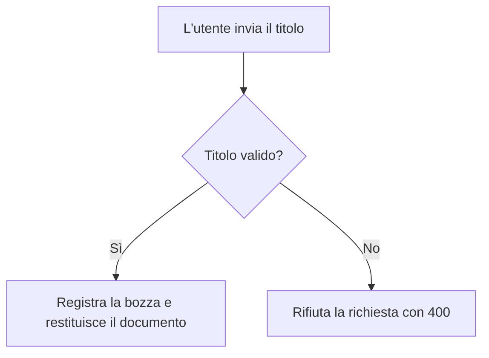
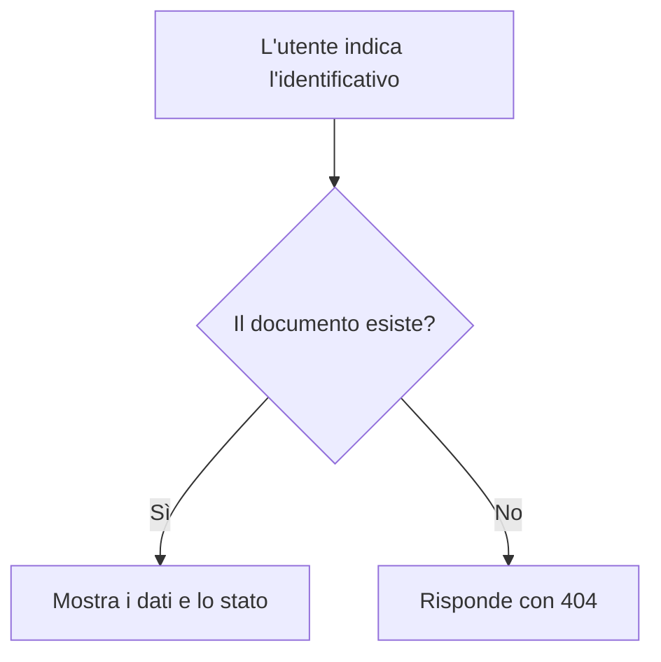
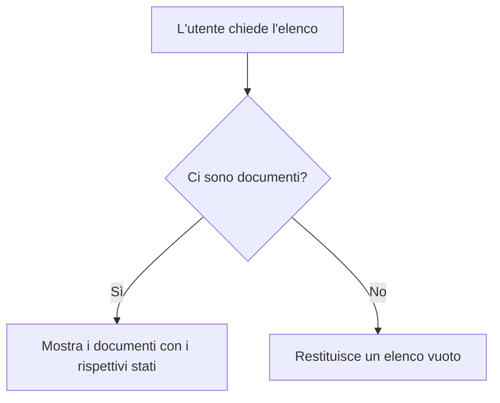
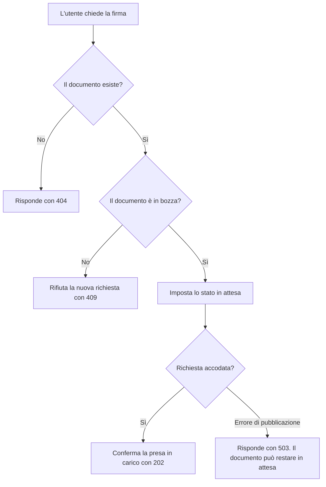
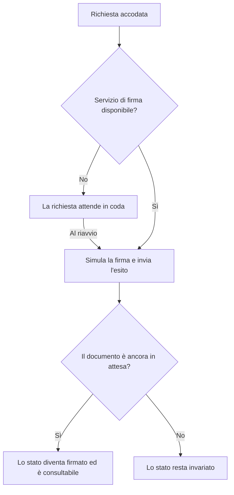

# Analisi funzionale

Il servizio permette di registrare documenti e seguirne la firma simulata. Tutte le operazioni rivolte all’utente richiedono credenziali valide. In caso contrario il servizio risponde con `401`.

## 1. Registrare un documento

L’utente invia un titolo non vuoto di massimo 200 caratteri. Il servizio registra la bozza e restituisce identificativo, titolo, stato e data di creazione.

## 2. Consultare un documento

L’utente usa l’identificativo ricevuto alla creazione per leggere il documento e controllare lo stato della firma.

## 3. Elencare i documenti

L’utente può consultare tutti i documenti registrati con il relativo stato. Se l’archivio è vuoto, riceve un elenco vuoto.

## 4. Richiedere la firma

Una bozza passa in attesa di firma. L’utente riceve conferma della presa in carico e può consultare il documento in seguito. Una nuova richiesta per un documento già in attesa o firmato restituisce `409`.

## 5. Completare la firma

Il servizio di firma elabora la richiesta in background. Se è fermo e RabbitMQ è disponibile, la richiesta resta in coda e viene elaborata dopo il riavvio. Al primo esito valido, il documento in attesa diventa firmato. Gli esiti ripetuti lasciano invariato lo stato.

## Risposte delle API

| Metodo e percorso | Risposta |
| --- | --- |
| `POST /api/documents` | `201` con documento e header `Location` |
| `GET /api/documents/{id}` | `200` con documento |
| `GET /api/documents` | `200` con elenco |
| `POST /api/documents/{id}/sign` | `202` con header `Location` |

Un titolo non valido o un identificativo con formato errato restituisce `400`.
