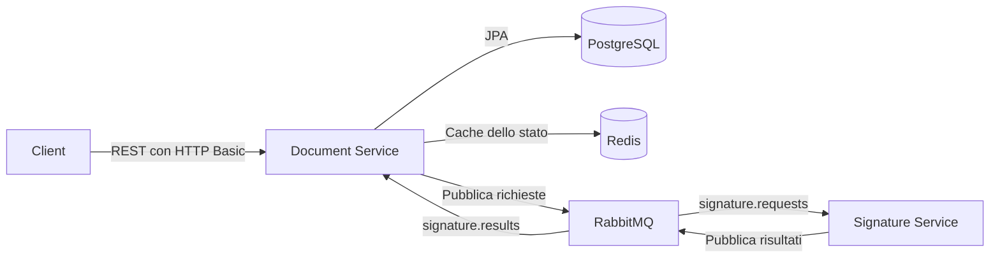
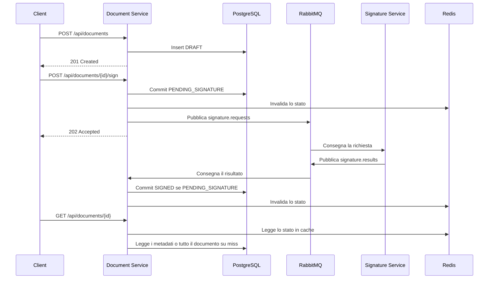
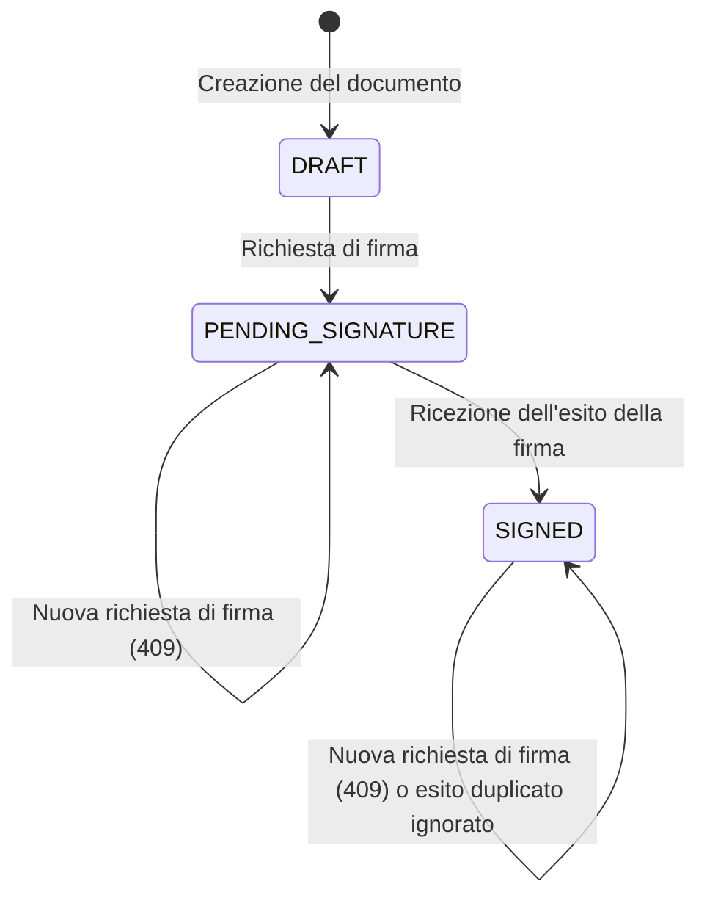

# Analisi tecnica

## Architettura

Docker Compose avvia due applicazioni Spring Boot su Java 21 e tre servizi di supporto. Il Document Service gestisce le API e lo stato. Il Signature Service elabora i messaggi di firma.

## Flusso del servizio

## Macchina a stati del documento

`SIGNED` è lo stato finale. Le frecce che tornano allo stesso stato indicano operazioni che lasciano il documento invariato. Se il documento passa a `PENDING_SIGNATURE` ma la pubblicazione della richiesta fallisce, può rimanere in attesa.

## Componenti e limiti

- **Document Service** espone REST con Spring MVC, HTTP Basic e Bean Validation. Usa JPA e aggiornamenti condizionali per proteggere le transizioni concorrenti.
- **Signature Service** consuma la richiesta e pubblica l’esito con gli stessi `documentId` ed `eventId`. Simula la firma senza database.
- **RabbitMQ** instrada messaggi JSON dall’exchange direct `signature` alle code durevoli `signature.requests` e `signature.results`. Ogni binding usa il nome della coda come routing key. Il producer attende la conferma del broker e verifica che il messaggio sia instradato. Il consumer invia l’ACK dopo il successo. Se il consumer è offline i messaggi attendono in coda. Gli errori tecnici nel listener hanno tre tentativi complessivi prima del rigetto senza requeue. RabbitMQ distribuisce lavoro con code e ACK. Kafka espone un log partizionato leggibile tramite offset.
- **Redis** usa il pattern cache-aside e conserva solo lo stato sotto `document:status:{id}` per cinque minuti. Su cache miss o errore Redis, il servizio legge da PostgreSQL e tenta di ripopolare la cache. Su hit legge da PostgreSQL solo i metadati. Invalida la chiave dopo il commit delle transizioni. L’elenco legge da PostgreSQL.

Il commit PostgreSQL e la pubblicazione RabbitMQ sono distinti. Se il commit riesce ma la pubblicazione fallisce, l’API restituisce `503` e il documento può rimanere in attesa. Un timeout del publisher può avere esito incerto. Un messaggio rigettato dopo i tentativi può lasciare il documento in attesa. Un errore di invalidazione o una lettura concorrente che ripopola la cache con lo stato precedente può lasciare un valore obsoleto fino alla scadenza. Le transizioni usano lo stato nel database.

Il progetto riprende da `payment-qa-lab` il Maven Wrapper, il modello di aggiornamento condizionale e l’approccio MockMvc e smoke test con timeout.
